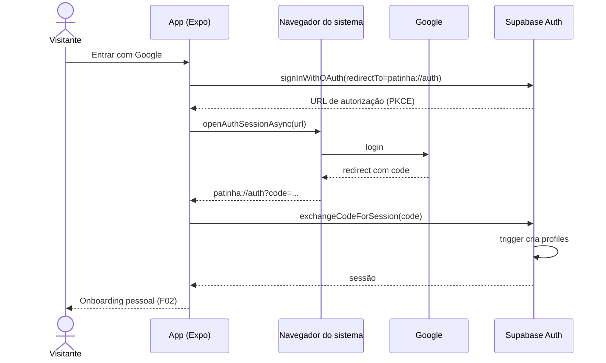
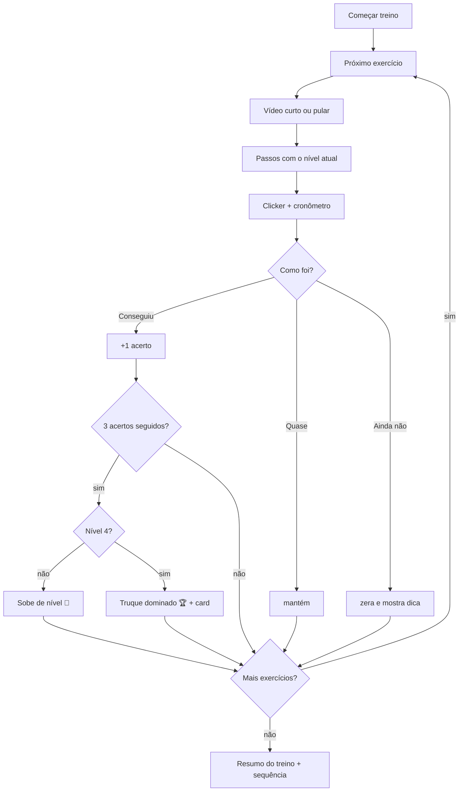
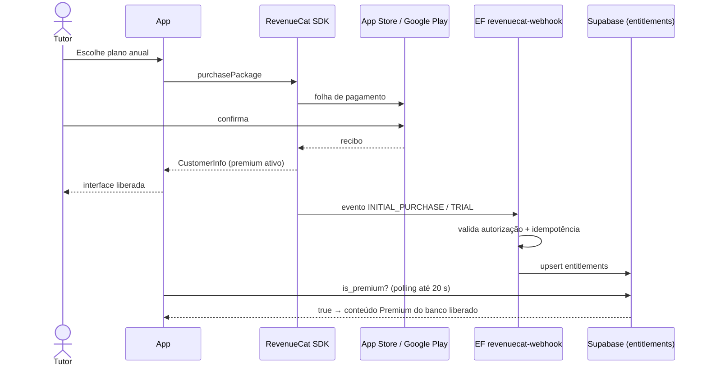

# Patinha — Mapa de fluxos do sistema

Referência dos fluxos do Patinha para implementação e testes. Complementa o `docs/roadmap.md`: os nomes de tabelas, funções e fases seguem o roadmap, e cada fluxo indica a fase em que nasce.

**Convenções:**
- `RPC:nome` é uma função SQL chamada via `supabase.rpc`; `EF:nome` é uma Edge Function; `→` separa a ação do usuário da resposta do sistema.
- As mensagens entre aspas são o texto exato da tela.
- Os comportamentos que valem para todas as telas (sem internet, sessão expirada, erro inesperado, atualização do app) estão na seção **X**.
- **Regras de tom, que valem para todo texto:**
  - **incentivo, nunca culpa:** "Ainda não" é parte do treino, e o app nunca chama o cão ou o tutor de "teimoso", "burro" ou "fracasso";
  - **bem-estar animal:** só reforço positivo, sem promessa de resultado garantido, e casos graves vão para um profissional (ADR-07).

---

## 1. Atores

| ID | Ator | Descrição |
|---|---|---|
| A1 | Visitante | Pessoa que abriu o app sem estar logada |
| A2 | Tutor | Usuário logado, plano grátis |
| A3 | Tutor Premium | Tutor com `entitlements` ativo ou em teste |
| A4 | Operador | Você: publica conteúdo, liga e desliga features, faz o suporte |
| A5 | Adestrador parceiro | Revisa e assina o conteúdo (fora do app; aparece como `reviewed_by`) |
| S1 | App (Expo, iOS/Android) | Telas, estado local, fila offline, clicker, cards |
| S2 | Supabase | Postgres, RLS, Auth, Storage, Edge Functions, pg_cron |
| E1 | Google / Apple (login) | Autenticação |
| E2 | App Store / Google Play | Compras e assinaturas |
| E3 | RevenueCat | SDK de compras e webhook de assinaturas |
| E4 | Expo Push / APNs / FCM | Entrega de notificações |
| E5 | Cloudflare R2 | Vídeos das lições |
| E6 | Instagram / WhatsApp (folha de compartilhar) | Destino dos cards |
| E7 | Sentry / PostHog | Erros e eventos |
| J1 | pg_cron (a cada hora) | Lembretes e fechamento de dias |

---

## 2. Lista completa de fluxos

| ID | Fluxo | Ator | Fase |
|---|---|---|---|
| **A. Conta** ||||
| F01 | Primeiro acesso (cadastro com Google ou Apple) | A1 | 1 |
| F02 | Onboarding pessoal (nome, 18+, fuso) | A2 | 1 |
| F03 | Login recorrente | A1 | 1 |
| F04 | Sair | A2 | 1 |
| F05 | Editar perfil e preferências | A2 | 1 |
| F06 | Baixar meus dados (LGPD) | A2 | 13 |
| F07 | Excluir conta dentro do app | A2 | 13 |
| **B. Cães** ||||
| F08 | Cadastrar o cão (onboarding do cão) | A2 | 3 |
| F09 | Editar o cão | A2 | 3 |
| F10 | Adicionar outro cão | A3 | 3 |
| F11 | Trocar o cão ativo | A2 | 3 |
| F12 | Arquivar ou excluir o cão | A2 | 3 |
| **C. Plano e conteúdo** ||||
| F13 | Gerar o plano personalizado | S2 | 5 |
| F14 | Ver o plano e trocar de programa | A2 | 5 |
| F15 | Explorar a biblioteca (filtrar e buscar) | A2 | 4 |
| F16 | Ver o detalhe de um exercício | A2 | 4 |
| **D. Treino** ||||
| F17 | Ver o treino do dia | A2 | 5 |
| F18 | Fazer a sessão guiada (vídeo, passos, clicker) | A2 | 6 |
| F19 | Registrar o resultado e progredir de nível | A2 | 6 |
| F20 | Treino livre (fora do plano) | A2 | 6 |
| F21 | Desfazer um resultado | A2 | 6 |
| **E. Gamificação** ||||
| F22 | Calcular e exibir a sequência do cão | S2 | 7 |
| F23 | Usar congelamento | A2 | 7 |
| F24 | Ganhar conquista | S2 | 7 |
| F25 | Ver a carteirinha de truques | A2 | 7 |
| F26 | Participar do desafio do mês | A2 | 11 |
| **F. Compartilhar** ||||
| F27 | Gerar e compartilhar card | A2 | 9 |
| F28 | Salvar card na galeria | A2 | 9 |
| **G. Notificações** ||||
| F29 | Permitir notificações e escolher o horário | A2 | 8 |
| F30 | Receber e tocar no lembrete | E4 | 8 |
| **H. Offline e versões** ||||
| F31 | Treinar offline | A2 | 10 |
| F32 | Receber uma atualização do app | S1 | 14 |
| **I. Assinatura** ||||
| F33 | Ver o paywall | A2 | 12 |
| F34 | Assinar (com teste grátis) | A2 | 12 |
| F35 | Restaurar compras | A2 | 12 |
| F36 | Renovação, expiração e falha de cobrança (webhook) | E3 | 12 |
| F37 | Cancelar a assinatura | A3 | 12 |
| F38 | Tentar usar recurso Premium | A2 | 12 |
| **J. Conteúdo e operação** ||||
| F39 | Publicar conteúdo (content/ → banco) | A4 | 4 |
| F40 | Feature flags, manutenção e suporte | A4 | 13 |
| **K. Permissões** ||||
| F41 | Permissão negada | A1 | 13 |
| **L. Jobs** ||||
| F42 | Job de lembretes | J1 | 8 |
| F43 | Job de manutenção | J1 | 8 |

### 2.1 Checagem de cobertura obrigatória

| Item | Situação |
|---|---|
| Cadastro | F01, F02 |
| Verificação de e-mail | **Descartado:** só login social (Google e Apple), com o e-mail já verificado pelo provedor |
| Login e logout | F03, F04 |
| Recuperação de senha | **Descartado:** não existe senha |
| Onboarding | F02 (pessoal), F08 (cão), F13 (plano) |
| CRUD das entidades principais | `profiles` F01/F05/F07 · `dogs` F08–F12 · `dog_goals` F08/F09 · `dog_programs` F13/F14 · `training_sessions` F19–F21 · `dog_skills` F19 · `dog_days`/`streak_freezes` F22/F23 · `dog_achievements` F24 · `challenge_entries` F26 · `push_tokens` F29/F43 · `entitlements` F36 · conteúdo F39 · `app_config` F40 |
| Busca e filtragem | F15 (biblioteca), F14 (programas), F25 (carteirinha) |
| Permissão negada | F41 |
| Sessão expirada | X.2 |
| Pagamento e falha de pagamento | F33–F38 |
| Fluxos administrativos | F39, F40 |
| Jobs em background | F36 (webhook), F42, F43 |
| Moderação | **Descartada no MVP:** não há conteúdo público de usuários (ADR-08) |

---

## 3. Detalhamento dos fluxos

### A. Conta

#### F01 — Primeiro acesso
- **Ator:** Visitante. **Gatilho:** "Entrar com Google" ou, no iOS a partir da Fase 14, "Entrar com Apple".
- **Pré-condições:** o app está instalado e sem sessão.

**Passos:**
1. A tela de boas-vindas mostra 3 telas curtas (treino de 10 min/dia, níveis e conquistas, card para postar) e os botões de login.
2. **Google:** `signInWithOAuth` com `redirectTo` pelo scheme `patinha://` → `openAuthSessionAsync` → o Google autentica → o app recebe o código e troca pela sessão (PKCE).
3. **Apple (iOS):** `expo-apple-authentication` → identityToken → `supabase.auth.signInWithIdToken({provider:'apple'})`.
4. → o trigger cria `profiles`, com `is_adult_confirmed = false`.
5. → o app vai para o F02.

**Alternativos:**
- **2a. A Apple oculta o e-mail:** a conta funciona com o e-mail de retransmissão.

**Erros:**
- **2e. Cancelou o navegador:** "Login cancelado. Tente de novo quando quiser."
- **2e. Falha na troca do código:** "Não foi possível entrar. Tente novamente."
- **2e. Sem internet:** "Sem conexão. Conecte-se para entrar."

**Pós-condições:** sessão ativa (persistida no aparelho) + `profiles`.

**Efeitos:** evento `signup {provider}`.

#### F02 — Onboarding pessoal
- **Ator:** Tutor. **Gatilho:** `is_adult_confirmed = false`.

**Passos:**
1. A tela mostra o nome (vem do provedor, editável), o checkbox "Tenho 18 anos ou mais" (com link para os termos) e o fuso detectado (`expo-localization`).
2. "Continuar" → `update profiles` (nome, fuso) + `RPC:confirm_adult()`.
3. → o F08 (cadastro do cão).

**Erros:**
- **1e. Sem marcar 18+:** o botão fica desabilitado, com a dica "O Patinha é para tutores maiores de 18 anos."
- **1e. Nome vazio ou com mais de 40 caracteres:** "Use um nome de 1 a 40 caracteres."

**Efeitos:** evento `onboarding_completed`.

#### F03 — Login recorrente
- **Ator:** Visitante. **Gatilho:** abrir o app sem sessão válida, ou depois de sair.

**Passos:**
1. Os passos 2 e 3 do F01.
2. → com o perfil completo, vai para Hoje; sem cão cadastrado, para o F08.

**Erros:** os mesmos do F01.

**Pós-condições:** sessão ativa. Antes de usar os dados, o app sincroniza a fila offline (F31).

#### F04 — Sair
- **Ator:** Tutor. **Gatilho:** Perfil → "Sair".

**Passos:**
1. Confirmação: "Sair da sua conta neste aparelho?"
2. → `signOut()` → apaga o token de push deste aparelho em `push_tokens` → limpa os caches locais (vídeos baixados ficam; dados pessoais saem).

**Alternativos:**
- **Há itens na fila offline:** o aviso "Você tem 2 treinos ainda não enviados. Sair mesmo assim vai perdê-los." aparece com "Enviar agora" ou "Sair mesmo assim".

#### F05 — Editar perfil e preferências
- **Ator:** Tutor. **Gatilho:** aba Perfil.

**Passos:**
1. Edita o nome, o fuso, a virada do dia (0 a 6h, com explicação) e o horário do lembrete.
2. → `update profiles` (o grant por coluna impede mexer em `is_adult_confirmed`).

**Alternativos:**
- **Mudou o fuso ou a virada:** "Isso vale daqui pra frente. Dias já registrados não mudam."

**Erros:**
- **Falha de rede:** "Não foi possível salvar agora. Tente de novo."

#### F06 — Baixar meus dados
- **Ator:** Tutor. **Gatilho:** Perfil → Privacidade → "Baixar meus dados".

**Passos:**
1. → `EF:export-data` reúne o perfil, os cães, os objetivos, as sessões, os níveis, as conquistas, os desafios e o estado da assinatura.
2. → gera o arquivo JSON e abre a folha de compartilhamento (`expo-sharing`) para a pessoa salvar ou enviar.

**Erros:**
- **Rate limit** (3 por dia): "Você já baixou seus dados hoje. Tente amanhã."

#### F07 — Excluir conta dentro do app
- **Ator:** Tutor. **Gatilho:** Perfil → Privacidade → "Excluir minha conta".

**Passos:**
1. Aviso: "Isso apaga para sempre seus cães, treinos, conquistas e fotos."
   - **Se houver assinatura ativa:** "Sua assinatura é cobrada pela loja. Cancele em Ajustes (iPhone) ou no Google Play antes de excluir, senão a cobrança continua." com o botão "Abrir assinaturas da loja".
2. A pessoa digita "EXCLUIR" → `EF:delete-account`: apaga as fotos do Storage e os `push_tokens`, depois `auth.admin.deleteUser`, com cascade.
3. → o app limpa tudo localmente e volta para a boas-vindas, com "Sua conta foi excluída."

**Erros:**
- **Texto errado:** "Digite EXCLUIR para confirmar."
- **Falha na função:** "Não foi possível excluir agora. Nada foi apagado. Tente de novo ou fale com o suporte."

**Efeitos:** evento anônimo `account_deleted`.

### B. Cães

#### F08 — Cadastrar o cão
- **Ator:** Tutor. **Gatilho:** depois do F02, ou "Adicionar cão" (F10).

**Passos (uma pergunta por tela, com barra de progresso):**
1. "Como seu cão se chama?"
2. Foto: câmera ou galeria → compressão para 1080 px → upload para `dog-photos/<uid>/<dog_id>.jpg` (bucket privado).
3. Idade: filhote (até 6 meses), jovem (6 a 18 meses), adulto ou idoso, com o mês aproximado de nascimento.
4. Porte: mini, pequeno, médio, grande ou gigante, com ilustração.
5. Raça: busca numa lista local, com **"Vira-lata 💛"** como primeira opção.
6. Energia: "Calmo", "No meio-termo" ou "Furacão".
7. "O que está te incomodando?" (pode marcar vários): xixi no lugar errado, puxa a guia, late demais, morde tudo, pula nas pessoas, não vem quando chamo, fica ansioso sozinho, quero ensinar truques, é filhote e quero começar certo.
8. "Quanto tempo você tem por dia?" 5, 10 ou 15 minutos.
9. → insert em `dogs` + `dog_goals` → `active_dog_id` → o F13 gera o plano → tela "O plano do Caramelo está pronto 🐾".

**Alternativos:**
- **2a. Pular a foto:** o app usa um avatar ilustrado com a inicial.
- **7a. Triagem (ADR-07):** ao marcar "morde tudo" ou "fica ansioso sozinho", o app pergunta a intensidade:
  - **Leve** ("morde de brincadeira", "chora um pouco"): segue normalmente.
  - **Grave** ("já mordeu alguém e machucou", "se machuca ou destrói portas quando sozinho"): `flagged_severe = true` e o aviso "Esse comportamento merece a ajuda de um adestrador presencial ou de um veterinário comportamentalista. Aqui no Patinha você pode treinar outras coisas enquanto isso, mas não vamos montar um plano para esse ponto." O objetivo fica fora do plano.

**Erros:**
- **1e. Nome vazio ou com mais de 30 caracteres:** "Use um nome de 1 a 30 caracteres."
- **2e. Upload falhou:** "Não conseguimos enviar a foto. Você pode tentar de novo depois." (o cadastro segue sem foto)
- **9e. Limite de cães** (trigger): "No plano grátis você cadastra 1 cão. Com o Premium, até 5." com o link para o F33.

**Pós-condições:** `dogs`, `dog_goals` e `dog_programs` criados.

**Efeitos:** evento `dog_created {size, is_srd, goals}`.

#### F09 — Editar o cão
- **Ator:** Tutor. **Gatilho:** Carteirinha → "Editar".

**Passos:**
1. Edita qualquer campo do F08.
2. → update.

**Alternativos:**
- **Mudou os objetivos ou o tempo por dia:** "Quer atualizar o plano do Caramelo?" com "Atualizar" (refaz o F13 mantendo os níveis já conquistados) ou "Manter o atual".

**Erros:** os mesmos do F08.

#### F10 — Adicionar outro cão
- **Ator:** Tutor Premium. **Gatilho:** "Meus cães" → "+".

**Passos:**
1. → F08.

**Alternativos:**
- **Usuário grátis:** o paywall do F33, com o contexto "Mais cães no Premium".

**Erros:**
- **Mais de 5 cães ativos:** "Você chegou ao limite de 5 cães. Arquive um para adicionar outro."

#### F11 — Trocar o cão ativo
- **Ator:** Tutor. **Gatilho:** toque na foto do cão no topo da tela Hoje.

**Passos:**
1. → seletor com os cães → `update profiles.active_dog_id`.
2. → Hoje, o plano, a sequência e a carteirinha passam a mostrar o cão escolhido.

#### F12 — Arquivar ou excluir o cão
- **Ator:** Tutor. **Gatilho:** Carteirinha → "⋯".

**Passos:**
1. **Arquivar:** "Arquivar o Caramelo? O histórico fica guardado e você pode reativar depois." → `archived_at = now()`.
2. **Excluir:** "Excluir para sempre o Caramelo e todo o histórico de treino?" → delete (cascade) + apaga a foto.

**Alternativos:**
- **Era o cão ativo:** outro cão vira o ativo; se não houver nenhum, a pessoa vai para o F08.
- **Reativar:** em "Meus cães → Arquivados", sujeito ao limite do plano.

**Pós-condições:** o cão some de Hoje.

**Efeitos:** os lembretes deixam de citar esse cão.

> **Nota:** se o cão faleceu, o tom precisa ser outro. Inclua a opção "O Caramelo partiu 🌈", que arquiva com uma mensagem de carinho e **nunca** mais manda lembrete nem card daquele cão.

### C. Plano e conteúdo

#### F13 — Gerar o plano personalizado
- **Ator:** Supabase. **Gatilho:** fim do F08, "Atualizar plano" (F09) ou troca de programa (F14).

**Passos:**
1. → `RPC:build_plan(dog_id)` lê:
   - os `dog_goals` sem `flagged_severe`;
   - a idade, a energia e `daily_minutes`;
   - os níveis já conquistados em `dog_skills`;
   - o plano do usuário (`is_premium`).
2. → escolhe o **programa principal** (o objetivo de maior prioridade: filhote > xixi > guia > mordida > pular > chamado > latido > truques) e o programa base **"Fundamentos"** (atenção, nome, senta).
3. → cria ou atualiza `dog_programs` (`ativo`); o programa anterior vira `pausado`.
4. → o treino de cada dia é montado na hora pelo F17, a partir de `program_items` + revisão.

**Alternativos:**
- **2a. O principal é Premium e o usuário é grátis:** o principal entra como `pausado`, com o cadeado ("Desbloqueie o plano completo do Caramelo"), e o "Fundamentos" vira o ativo.
- **2b. Só objetivos graves:** "Fundamentos" + truques leves, com o aviso da triagem visível no plano.
- **2c. Filhote com menos de 4 meses:** treinos de até 5 min, independentemente do tempo escolhido.

**Erros:**
- **1e. Falha:** "Não conseguimos montar o plano agora. Tente de novo." com o botão de tentar outra vez. **Nunca** mostre um plano vazio sem explicação.

#### F14 — Ver o plano e trocar de programa
- **Ator:** Tutor. **Gatilho:** aba Plano.

**Passos:**
1. → mostra o programa atual (semana X de Y, % concluído), as próximas sessões e os outros programas compatíveis.
2. "Trocar programa" → lista filtrada pela idade e pelos objetivos → escolhe → F13 com o programa escolhido.

**Alternativos:**
- **Programa Premium para quem é grátis:** F38.

**Erros:**
- **Programa não compatível com a idade** (ex.: "Na rua sem puxar" para um filhote de 2 meses): "Esse programa é para cães a partir de 4 meses." (a opção aparece desabilitada)

#### F15 — Explorar a biblioteca
- **Ator:** Tutor. **Gatilho:** aba Explorar.

**Passos:**
1. → lista os exercícios publicados por categoria (Obediência, Comportamento, Truques, Enriquecimento), com o nível do cão ativo em cada um.
2. Filtros: categoria, objetivo, duração e "não comecei / em andamento / dominado". Busca por título sem diferenciar acentos.

**Alternativos:**
- **Exercícios Premium:** aparecem com cadeado e mostram título e resumo.

**Erros:**
- **Nenhum resultado:** "Nada por aqui. Tente outra palavra ou tire um filtro."

#### F16 — Ver o detalhe de um exercício
- **Ator:** Tutor. **Gatilho:** toque num exercício.

**Passos:**
1. → `RPC:get_exercise(slug)` → título, resumo, vídeo (URL do R2), passos, dicas, nota de segurança e os níveis 1 a 4 com o critério de cada um.
2. → o player (`expo-video`) toca com controle de som e repetição.
3. → botões "Treinar agora" (F20) e "Ver na carteirinha".

**Alternativos:**
- **Premium bloqueado** (`locked = true`): prévia com cadeado e o botão "Desbloquear com o Premium" (F33).
- **Vídeo baixado** (F31): toca o arquivo local.

**Erros:**
- **O vídeo não carregou:** "O vídeo não carregou. Os passos abaixo continuam valendo." com "Tentar de novo".

### D. Treino

#### F17 — Ver o treino do dia
- **Ator:** Tutor. **Gatilho:** abrir o app (tela Hoje).

**Passos:**
1. → `RPC:today_workout(dog_id)` → 2 a 4 exercícios que cabem em `daily_minutes`:
   - os itens do dia atual do programa;
   - 1 de revisão (um exercício já aprendido, para não esquecer).

   Cada item vem com o nível alvo e o nível atual.
2. → a tela mostra a foto e o nome do cão, "Treino de hoje · 8 min", a sequência (F22), os cards dos exercícios e "Começar treino".

**Alternativos:**
- **Já treinou hoje:** "Treino de hoje feito ✅" com "Treinar mais um pouco" (treino livre, F20).
- **Desafio do mês ativo:** banner do F26.
- **Ontem ficou sem treino:** a oferta do F23.

**Erros:**
- **Falha ao carregar:** usa o treino em cache (F31) com a faixa "Mostrando o treino salvo no aparelho".

#### F18 — Fazer a sessão guiada
- **Ator:** Tutor. **Gatilho:** "Começar treino" ou "Treinar agora".

**Passos (para cada exercício):**
1. **Vídeo:** 30 a 60 s, com "Pular vídeo".
2. **Passos:** um por vez, com "Próximo"; o nível atual aparece em destaque ("Nível 2: sem petisco na mão").
3. **Clicker:** um botão grande toca o som curto do clique (`expo-audio`, pré-carregado para não atrasar) e vibra (`expo-haptics`). Ao lado, um cronômetro opcional.
4. **"Como foi?"** → Conseguiu! / Quase / Ainda não (F19).
5. → o próximo exercício, ou o resumo do treino.

**Alternativos:**
- **Sair no meio:** "Salvar o que já foi feito?" → os exercícios com resultado ficam gravados.
- **Som desligado no aparelho:** o clicker só vibra, com o aviso "Seu celular está no silencioso: o clique vai só vibrar."

**Erros:**
- **O som do clicker falhou:** fica só a vibração, sem travar a sessão.

#### F19 — Registrar o resultado e progredir de nível
- **Ator:** Tutor. **Gatilho:** resposta em "Como foi?".

**Passos:**
1. → insert em `training_sessions` `{dog_id, exercise_id, level, result, duration_sec, dog_program_id}`.
2. → o trigger BEFORE confere o dono, o dia lógico, hoje/ontem e o acesso Premium.
3. → o trigger AFTER cuida de:
   - **progressão em `dog_skills`:** "conseguiu" soma 1; "quase" mantém; "ainda_nao" zera; com 3 acertos seguidos, sobe de nível; no nível 4, grava `mastered_at`;
   - o upsert em `dog_days`;
   - o avanço do `current_day`;
   - a avaliação de conquistas (F24).
4. → o app mostra:
   - "Conseguiu!": "Boa! 2 de 3 acertos para subir de nível 💪";
   - "Quase": "Quase lá! Repete amanhã que ele pega o jeito.";
   - "Ainda não": "Faz parte! Dica para amanhã: <dica>.";
   - nível novo: "Subiu para o nível 2: sem petisco na mão! 🎉";
   - dominado: "Truque dominado! 🏆" com "Gerar card" (F27).

**Alternativos:**
- **Offline:** o resultado vai para a fila local (F31), e a progressão aparece "prevista" até sincronizar.

**Erros:**
- **2e. Exercício Premium sem assinatura:** "Esse exercício é do Premium." (só acontece se alguém burlar a interface)
- **2e. Fora de hoje/ontem** (fila antiga): o item é descartado com o aviso do F31.

**Efeitos:** eventos `session_done`, `level_up` e `skill_mastered`.

#### F20 — Treino livre
- **Ator:** Tutor. **Gatilho:** "Treinar agora" num exercício da biblioteca, ou "Treinar mais um pouco".

**Passos:**
1. → F18 com um exercício só e `dog_program_id = null`.
2. → F19 normalmente: conta para os níveis, a sequência e as conquistas, mas não avança o plano.

**Erros:**
- **Exercício acima da idade do cão:** "Esse exercício é para cães a partir de 4 meses. Que tal o Fundamentos?"

#### F21 — Desfazer um resultado
- **Ator:** Tutor. **Gatilho:** Carteirinha → Histórico → toque num resultado com até 24 h → "Desfazer".

**Passos:**
1. Confirmação: "Desfazer o resultado 'Conseguiu' de Senta (hoje, 19:42)?"
2. → delete (RLS: o próprio registro, até 24 h) → `RPC:recompute_skill(dog_id, exercise_id)` recalcula o nível a partir das sessões restantes.

**Alternativos:**
- **O cão tinha subido de nível com esse resultado:** o nível volta; as conquistas ganhas **não** são retiradas.

**Erros:**
- **Mais de 24 h:** "Resultados com mais de 24 horas não podem ser desfeitos."

> **Nota:** `recompute_skill` não está no roadmap. Inclua-a na Fase 6. Ela torna o desfazer seguro.

### E. Gamificação

#### F22 — Sequência do cão
- **Ator:** Supabase. **Gatilho:** F17 e F19.

**Passos:**
1. → `RPC:get_dog_streak(dog_id)` → conta para trás os dias seguidos em `dog_days`, a partir de hoje (se o cão treinou) ou de ontem (se ainda não).
2. → retorna `{current, longest, trained_today, freeze_available}`.
3. → a tela Hoje mostra "🔥 12 dias treinando".

**Regra de tom:** quando a sequência zera, a mensagem é "Recomeço também conta. Bora hoje? 🐾", nunca "Você perdeu tudo".

**Erros:**
- **Falha:** o bloco mostra "—"; **nunca** mostre 0 por engano.

#### F23 — Usar congelamento
- **Ator:** Tutor. **Gatilho:** abrir o app depois de um dia sem treino, com sequência anterior de 2 dias ou mais.

**Passos:**
1. → "Ontem passou sem treino. Usar o congelamento da semana e manter os 12 dias do Caramelo? ❄️"
2. "Usar" → `RPC:use_freeze(dog_id, day)` → valida (até 7 dias atrás, dia sem treino, limite de 1 por semana ou 2 no Premium) → `streak_freezes` + `dog_days` (`congelado`).

**Erros:**
- **Já usou na semana:** "O congelamento desta semana já foi usado. Ele renova na segunda."
- **O dia teve treino:** "Esse dia já conta, não precisa congelar."

#### F24 — Ganhar conquista
- **Ator:** Supabase. **Gatilho:** o trigger AFTER INSERT de `training_sessions`.

**Passos:**
1. → avalia o catálogo (critérios verificáveis pelos dados) → insert em `dog_achievements` (`on conflict do nothing`).
2. → o app recebe e mostra a celebração (animação) com "Gerar card".

**Erros:** nenhum visível; uma falha só deixa de mostrar a celebração.

**Efeitos:** evento `achievement {code}`.

#### F25 — Ver a carteirinha de truques
- **Ator:** Tutor. **Gatilho:** aba do cão (Carteirinha).

**Passos:**
1. → mostra a foto, o nome, a idade, "Sabe 7 truques", a sequência e a grade de exercícios com a medalha do nível: 🥉 nível 1–2, 🥈 nível 3, 🥇 nível 4 e 🏆 dominado.
2. → abas "Truques", "Conquistas" e "Histórico".
3. → "Compartilhar carteirinha" (F27).

**Alternativos:**
- **Nenhum truque ainda:** "A carteirinha do Caramelo está esperando o primeiro truque. Bora treinar?"

#### F26 — Participar do desafio do mês
- **Ator:** Tutor. **Gatilho:** banner na tela Hoje (do dia 1 ao último dia do mês).

**Passos:**
1. → a tela do desafio: o título ("Mês do Dá a Pata"), a explicação, o exercício ligado e o contador "1.234 cães participando" (agregado e anônimo).
2. "Participar" → o exercício do desafio entra no treino do dia como item extra.
3. Quando o cão domina o exercício dentro do mês → `challenge_entries.completed_at` → a conquista do mês + o card "Desafio concluído".

**Alternativos:**
- **Desafio Premium para quem é grátis:** cadeado (F38).
- **Já dominava o exercício antes do mês:** "O Caramelo já domina esse! Conquista garantida 🏆" (conclui na hora).

**Erros:**
- **Mês encerrado:** "Esse desafio terminou. O de agora é <título>."

### F. Compartilhar

#### F27 — Gerar e compartilhar card
- **Ator:** Tutor. **Gatilho:** truque dominado, conquista, marco de sequência (7/30/100), carteirinha ou desafio concluído.

**Passos:**
1. → o app monta os dados (foto do cão em cache local, nome, truque, dias) e renderiza o template fora da tela, em 1080×1920.
2. → a pré-visualização tem a troca de paleta e a troca do texto curto entre sugestões.
3. "Compartilhar" → `captureRef` (PNG em arquivo temporário) → `expo-sharing` → a folha do sistema → a pessoa escolhe o Instagram Stories ou o WhatsApp.
4. → evento `card_shared {template}`.

**Alternativos:**
- **Sem foto do cão:** o template usa a ilustração com a inicial.
- **Tema Premium** escolhido por quem é grátis: F38.

**Erros:**
- **Falha na captura:** "Não conseguimos gerar a imagem. Tente de novo."
- **Folha cancelada:** nada acontece.

#### F28 — Salvar card na galeria
- **Ator:** Tutor. **Gatilho:** "Salvar" na pré-visualização.

**Passos:**
1. → pede a permissão da galeria (`expo-media-library`) **só agora** → salva o PNG → "Card salvo na galeria 📸".

**Erros:**
- **Permissão negada:** "Sem permissão não dá para salvar. Você ainda pode compartilhar direto." com o link para os ajustes.

### G. Notificações

#### F29 — Permitir notificações e escolher o horário
- **Ator:** Tutor. **Gatilho:** depois do primeiro treino concluído, ou Perfil → Notificações.

**Passos:**
1. → a tela própria, antes do pedido do sistema: "Quer um lembrete para não perder a sequência?", com a escolha do horário (padrão 19h).
2. "Ativar" → `requestPermissionsAsync` → aceita → `getExpoPushTokenAsync` → upsert em `push_tokens` (troca de dono via função se o token já existir).
3. → toast "Lembrete às 19h ✅".

**Alternativos:**
- **"Agora não":** o convite volta só depois de 3 treinos.
- **Toggles por tipo:** lembrete diário, conquistas e desafio do mês.

**Erros:**
- **Permissão negada:** "Sem permissão não conseguimos te lembrar. Dá para liberar nos ajustes do celular." com o botão que abre os ajustes.

#### F30 — Receber e tocar no lembrete
- **Ator:** Expo Push. **Gatilho:** F42.

**Passos:**
1. → a notificação chega: "Bora treinar? 🐾 Hoje: Senta + guia (8 min)".
2. Toque → o app abre em Hoje (deep link `patinha://hoje`).

**Erros:**
- **App sem sessão:** abre o login e, depois dele, Hoje.

### H. Offline e versões

#### F31 — Treinar offline
- **Ator:** Tutor / App. **Gatilho:** treinar sem conexão.

**Passos:**
1. **Preparo** (com Wi-Fi): o app baixa os vídeos do treino de hoje e de amanhã (até ~150 MB, apagando os antigos) e guarda o treino do dia em cache.
2. **Sem conexão:** faixa "Você está offline". O treino do dia, o clicker, os vídeos baixados e a carteirinha funcionam.
3. **Resultados:** vão para a fila local, com o `done_at` real.
4. **Ao reconectar:** o envio é feito em ordem → "Treinos sincronizados ✅" → a sequência e os níveis são atualizados.

**Erros:**
- **Item rejeitado** (ex.: virou anteontem): "Um treino não pôde ser salvo porque passou do prazo (só hoje ou ontem)."

**Fora do escopo offline:** cadastrar cão, assinar, trocar programa e gerar plano.

#### F32 — Receber uma atualização do app
- **Ator:** App. **Gatilho:** abrir o app.

**Passos:**
1. **Mudança só de JavaScript:** o `expo-updates` baixa em segundo plano e aplica na próxima abertura. Correções urgentes podem pedir "Reiniciar agora".
2. **Mudança nativa:** a versão mínima fica em `app_config.min_version`. Abaixo dela, o app mostra "Atualize o Patinha na loja para continuar" com o botão para a loja.

**Erros:**
- **Update corrompido:** o `expo-updates` volta para a última versão boa (comportamento padrão).

### I. Assinatura

#### F33 — Ver o paywall
- **Ator:** Tutor. **Gatilho:** F38, Perfil → "Premium", ou o fim do primeiro treino de um programa Premium em prévia.

**Passos:**
1. → `Purchases.getOfferings()` → os planos com o preço local vindo da loja (nunca fixo no código).
2. → a tela mostra:
   - o contexto ("Desbloqueie o plano completo do Caramelo");
   - 3 ou 4 benefícios;
   - o plano anual em destaque, com o teste grátis e o equivalente mensal;
   - o plano mensal;
   - "Restaurar compras";
   - os links para os termos e a privacidade;
   - "Cancele quando quiser pela loja".

**Erros:**
- **Offerings indisponíveis:** "Não conseguimos carregar os planos agora. Tente de novo em instantes."

**Efeitos:** evento `paywall_viewed {context}`.

#### F34 — Assinar (com teste grátis)
- **Ator:** Tutor. **Gatilho:** escolher um plano no paywall.

**Passos:**
1. → `Purchases.purchasePackage(pkg)` → a folha de pagamento da loja (Apple ou Google) → a pessoa confirma.
2. → o SDK devolve o `CustomerInfo` com o entitlement `premium` ativo → a interface libera na hora.
3. → em paralelo, o webhook do RevenueCat chama `EF:revenuecat-webhook` → upsert em `entitlements` (`teste` ou `ativo`, `expires_at`).
4. → o banco passa a liberar o conteúdo Premium (`is_premium`). Até o webhook chegar, o app consulta a cada 2 s por até 20 s; se demorar mais, mostra "Ativando seu Premium…" e tenta de novo depois.
5. → "Bem-vindo ao Premium 🐾" e de volta ao ponto de origem.

**Alternativos:**
- **Já usou o teste antes:** a loja cobra direto; o paywall mostra o preço sem a oferta de teste.

**Erros:**
- **A pessoa cancelou na folha da loja:** volta ao paywall, sem mensagem de erro.
- **Pagamento recusado ou pendente:** "A loja não concluiu o pagamento. Confira a forma de pagamento e tente de novo."
- **Webhook falhou:** o RevenueCat tenta de novo sozinho; o app continua tentando sincronizar (passo 4).

**Efeitos:** eventos `trial_started` e `subscribed`.

#### F35 — Restaurar compras
- **Ator:** Tutor. **Gatilho:** "Restaurar compras" (paywall ou Perfil).

**Passos:**
1. → `Purchases.restorePurchases()` → se houver assinatura ativa na conta da loja, o RevenueCat transfere para o usuário atual → webhook (`TRANSFER`) → `entitlements`.
2. → "Compras restauradas ✅" ou "Não encontramos assinatura ativa nesta conta da loja."

**Erros:**
- **Falha:** "Não foi possível restaurar agora. Tente de novo."

#### F36 — Renovação, expiração e falha de cobrança
- **Ator:** RevenueCat. **Gatilho:** os eventos da loja.

**Passos:**
1. → `EF:revenuecat-webhook` valida o header de autorização e ignora eventos repetidos (`event.id` já processado).
2. → atualiza `entitlements` conforme o evento:

| Evento | Novo estado |
|---|---|
| `RENEWAL` | `ativo`, novo `expires_at` |
| `CANCELLATION` | `cancelado`; o acesso continua até `expires_at` |
| `EXPIRATION` | `expirado` |
| `BILLING_ISSUE` | `cobranca_falhou`; o acesso continua no período de tolerância da loja |
| `UNCANCELLATION` | `ativo` |

3. → na próxima abertura, o app mostra o banner do estado:
   - "Problema na cobrança: atualize a forma de pagamento na loja.";
   - ou "Seu Premium termina em 12/11.".

**Erros:**
- **Header inválido:** 401, sem processar.
- **Erro interno:** 500; o RevenueCat tenta de novo.

**Pós-condições:** o banco reflete a loja. Com o Premium expirado, o conteúdo volta ao cadeado, mas **nenhum dado é apagado**: níveis, conquistas e cães extras ficam guardados (os cães extras ficam arquivados até a pessoa escolher qual manter ativo).

#### F37 — Cancelar a assinatura
- **Ator:** Tutor Premium. **Gatilho:** Perfil → "Gerenciar assinatura".

**Passos:**
1. → abre a tela de assinaturas da loja (o link do RevenueCat `managementURL`, ou o padrão da Apple ou do Google).
2. → a pessoa cancela na loja → o webhook `CANCELLATION` (F36).

**Regra:** o app não esconde nem dificulta o caminho para cancelar.

#### F38 — Tentar usar recurso Premium
- **Ator:** Tutor. **Gatilho:** programa, exercício, desafio ou tema de card Premium; segundo cão; segundo congelamento.

**Passos:**
1. → a prévia com cadeado → "Desbloquear com o Premium" → F33, com o contexto.

**Regra:** o paywall **nunca** interrompe um treino grátis em andamento, nem tira o acesso ao que já é grátis.

**Erros:**
- **Chamada direta à API sem Premium:** o banco recusa com "Esse conteúdo é do Premium." (a interface trata como cadeado)

### J. Conteúdo e operação

#### F39 — Publicar conteúdo
- **Ator:** Operador (com a revisão do adestrador). **Gatilho:** exercício, programa ou desafio novo ou alterado em `content/`.

**Passos:**
1. **Escrever ou alterar** o JSON em `content/` (skill `licao-adestramento`) e subir o vídeo no R2 com o nome versionado.
2. **Revisão:** o adestrador revisa (o roteiro de revisão da skill) → preencher `reviewed_by` e `reviewed_at`.
3. **Validação:** `python .claude/skills/licao-adestramento/scripts/validar_conteudo.py content/` localmente e no CI. O CI falha com erro.
4. **Importação:** depois do merge, rodar o `content:import` (dev) e, na produção, o workflow "content-prod" → `EF:import-content` faz o upsert por slug.
5. → o app vê o conteúdo novo na próxima consulta (sem precisar de build novo).

**Erros:**
- **3e. Item publicado sem `reviewed_by`, com termo proibido** (punição, enforcador, choque) **ou com vídeo sem URL:** o CI falha e a importação não roda.
- **4e. Slug duplicado ou programa apontando para exercício inexistente:** a função recusa o lote inteiro (transação).

#### F40 — Feature flags, manutenção e suporte
- **Ator:** Operador.

**Passos:**
1. **Flags:** `app_config` (`maintenance`, `min_version`, `challenge_enabled`, `paywall_variant`), lidas pelo app ao abrir, com cache de 5 min.
2. **Manutenção:** "Estamos fazendo uma melhoria rápida. Voltamos já 🐾".
3. **Suporte** (e-mail de contato nas lojas e no site):
   - problemas de assinatura vão para a loja ou o RevenueCat;
   - exclusão de conta pedida por e-mail: faça pelo painel do Supabase depois de confirmar a identidade.

### K. Permissões

#### F41 — Permissão negada

| Situação | Detecção | O que a pessoa vê |
|---|---|---|
| Sem sessão em telas do app | guarda do Expo Router | volta para a boas-vindas e o login |
| Sem a autodeclaração 18+ | guarda | o onboarding pessoal (F02) |
| Sem cão cadastrado | guarda | o cadastro do cão (F08) |
| Ler ou alterar o cão, as sessões ou a foto de outro usuário | RLS / políticas do Storage | "Isso não é seu." (registrado como suspeito no Sentry) |
| Conteúdo Premium sem assinatura | `is_premium` no banco | cadeado (F38) |
| Desfazer resultado com mais de 24 h ou de outra pessoa | RLS | "Esse resultado não pode mais ser desfeito." |
| Permissões do celular negadas (câmera, galeria, notificações) | APIs do Expo | explicação + botão para os ajustes do sistema; o app continua funcionando sem a função |
| Webhook ou função sem segredo | header | 401, sem corpo útil |

### L. Jobs

#### F42 — Job de lembretes
- **Ator:** pg_cron (a cada hora). **Gatilho:** `cron.schedule` → `pg_net` → `EF:send-reminders` (com segredo).

**Passos:**
1. → seleciona os usuários cujo `reminder_hour` no fuso local é a hora atual, com o lembrete ligado, com um cão ativo que **ainda não treinou hoje** (dia lógico) e fora do horário silencioso (22h–8h).
2. → monta a mensagem a partir do treino de hoje e da sequência:
   - "Bora treinar? 🐾 Hoje: Senta + guia (8 min)";
   - com sequência de 3 dias ou mais: "Não deixa a sequência de 12 dias do Caramelo cair 🔥".
3. → envia pela API de push do Expo em lotes de até 100 e lê os recibos depois. `DeviceNotRegistered` apaga o token.

**Regra:** os cães arquivados ou marcados como falecidos (F12) **nunca** geram lembrete.

**Erros:**
- **Falha na API:** 1 nova tentativa; depois, registro no Sentry.

#### F43 — Job de manutenção
- **Ator:** pg_cron (diário, 4h UTC).

**Passos:**
1. **Tokens de push:** apagar os de usuários sem abrir o app há mais de 90 dias.
2. **Eventos do RevenueCat:** apagar os processados há mais de 30 dias.
3. **Conferência de entitlements:** marcar como `expirado` quem tem `expires_at` vencido há mais de 3 dias sem evento novo (proteção contra webhook perdido; o próximo evento corrige).
4. **Fotos órfãs:** apagar do Storage as fotos sem cão correspondente há mais de 7 dias.

**Erros:** cada etapa é isolada e vai para o Sentry em caso de falha.

---

## X. Comportamentos transversais

#### X.1 — Sem internet
- **Funciona offline:** o treino do dia, o clicker, a carteirinha e os vídeos baixados (F31).
- **Ações que exigem servidor:** ficam desabilitadas, com "Você está offline".

#### X.2 — Sessão expirada
- **Renovação:** o `supabase-js` renova o token automaticamente quando o app volta para o primeiro plano.
- **Se a renovação falhar:** o app vai para o login com "Sua sessão expirou. Entre de novo."
- **Ao abrir o app:** a sessão salva no aparelho é conferida no servidor (`auth.getUser()`). Se o usuário não existe mais ou o token foi recusado, o app sai só deste aparelho e vai para o login com a mesma mensagem. Sem internet, a sessão fica (uso offline).
- **Perfil ausente para um usuário válido:** o app cria o perfil com `RPC:ensure_profile` em vez de mostrar erro.
- **Fila offline:** é mantida e enviada depois do login, se o usuário for o mesmo.

#### X.3 — Erro inesperado
- **Na tela:** "Algo deu errado do nosso lado. Já fomos avisados." com "Tentar de novo" e "Sair" (só deste aparelho, volta para a entrada), para o usuário nunca ficar preso.
- **"Detalhes":** em desenvolvimento e nos previews (não em produção), mostra o código e a mensagem técnica do erro, até o Sentry entrar (Fase 13).
- **No Sentry:** o erro chega com a versão do app, o canal do EAS Update e o usuário.

#### X.4 — App em segundo plano durante a sessão
- O cronômetro usa o horário de início (não conta em segundo plano) e retoma certo.
- O vídeo pausa e retoma.
- Uma ligação no meio do treino não perde os resultados já marcados.

#### X.5 — Acessibilidade
- O clicker e todos os botões de resultado têm rótulo de acessibilidade.
- Os vídeos têm passos escritos equivalentes.
- O contraste respeita o mínimo de 4,5:1.

---

## 4. Matriz de rastreabilidade

| Fluxo | Entidades | Funções / endpoints |
|---|---|---|
| F01 Primeiro acesso | auth.users, profiles | `signInWithOAuth`, `exchangeCodeForSession`, `signInWithIdToken` (Apple), trigger de profiles |
| F02 Onboarding pessoal | profiles | update, `RPC:confirm_adult` |
| F03 Login | profiles, dogs | Auth, `auth.getUser` (sessão salva), `RPC:ensure_profile` |
| F04 Sair | push_tokens | `signOut`, delete do token |
| F05 Perfil | profiles | update (grant por coluna) |
| F06 Exportar | todas do usuário | `EF:export-data` |
| F07 Excluir conta | todas (cascade), storage | `EF:delete-account` |
| F08 Cadastrar cão | dogs, dog_goals, storage dog-photos, dog_programs | insert + trigger de limite, `RPC:build_plan` |
| F09 Editar cão | dogs, dog_goals | update, `RPC:build_plan` |
| F10 Outro cão | dogs, entitlements | trigger de limite |
| F11 Trocar cão ativo | profiles | update `active_dog_id` |
| F12 Arquivar/excluir | dogs (cascade), storage | update/delete |
| F13 Gerar plano | dog_goals, dog_skills, programs, dog_programs, entitlements | `RPC:build_plan` |
| F14 Plano/trocar | dog_programs, programs | `RPC:build_plan` |
| F15 Biblioteca | exercises, dog_skills | select (view pública sem campos Premium) |
| F16 Detalhe | exercises, entitlements | `RPC:get_exercise`, R2 |
| F17 Treino do dia | program_items, dog_programs, dog_skills | `RPC:today_workout` |
| F18 Sessão | — (cliente) | expo-video, expo-audio, expo-haptics |
| F19 Resultado | training_sessions, dog_skills, dog_days, dog_programs, dog_achievements | insert + triggers |
| F20 Treino livre | training_sessions | insert |
| F21 Desfazer | training_sessions, dog_skills | delete, `RPC:recompute_skill` |
| F22 Sequência | dog_days, streak_freezes | `RPC:get_dog_streak` |
| F23 Congelamento | streak_freezes, dog_days | `RPC:use_freeze` |
| F24 Conquista | dog_achievements | trigger |
| F25 Carteirinha | dog_skills, dog_achievements, training_sessions | select |
| F26 Desafio | challenges, challenge_entries, dog_skills | select, insert, `RPC:challenge_count` |
| F27 Card | (leitura) dogs, dog_skills, dog_achievements | view-shot, expo-sharing |
| F28 Salvar card | — | expo-media-library |
| F29 Notificações | push_tokens, profiles | `RPC:upsert_push_token` |
| F30 Receber lembrete | — | expo-notifications, deep link |
| F31 Offline | (fila local) | expo-file-system, NetInfo |
| F32 Atualização | app_config | expo-updates |
| F33 Paywall | — | `Purchases.getOfferings` |
| F34 Assinar | entitlements | `purchasePackage`, `EF:revenuecat-webhook` |
| F35 Restaurar | entitlements | `restorePurchases`, webhook |
| F36 Renovação/expiração | entitlements, rc_events | `EF:revenuecat-webhook` |
| F37 Cancelar | entitlements | loja + webhook |
| F38 Recurso Premium | entitlements | `is_premium` |
| F39 Publicar conteúdo | exercises, programs, program_items, challenges | validador, `EF:import-content` |
| F40 Operação | app_config | Studio |
| F41 Permissão negada | todas (RLS) | guardas do Router, políticas |
| F42 Lembretes | push_tokens, profiles, dog_days | pg_cron, `EF:send-reminders`, API de push do Expo |
| F43 Manutenção | push_tokens, rc_events, entitlements, storage | pg_cron |

---

## 5. Itens que o roadmap ainda não cobre

| Item | Por quê | Fase |
|---|---|---|
| `RPC:recompute_skill` | Desfazer um resultado precisa recalcular o nível com segurança (F21) | 6 |
| Opção "O cão partiu 🌈" ao arquivar | Tom e respeito: nunca mais lembrar nem gerar card daquele cão (F12) | 3 |
| Tabela `rc_events(id text PK, processed_at)` | Idempotência do webhook do RevenueCat (F36) | 12 |
| Arquivamento dos cães extras quando o Premium expira | Cumprir o limite de 1 cão sem apagar nada (F36) | 12 |
| `app_config.min_version` + tela de atualização obrigatória | Mudanças nativas que exigem a versão nova da loja (F32) | 14 |
| `RPC:upsert_push_token` (troca de dono) | O mesmo aparelho usado por outra conta (F29) | 8 |
| View pública da biblioteca sem os campos Premium | A lista não pode vazar o `video_url` e os passos (F15) | 4 |
| `reviewed_at` em exercises/programs | Rastreabilidade da revisão (F39) | 4 |
| Limite de troca de fuso/virada do dia: 1 por 24 h (`timezone_changed_at` + trigger) e sem fusos `Etc/`, `posix/` e `right/` | Trocar o fuso em sequência permite gravar um treino atrasado num dia lógico já fechado (ADR-05; revisão de segurança da Fase 1) | 6 |
| Tabelas novas exigem 18+ confirmado no banco (`with check` com `profiles.is_adult_confirmed`) | Quem chama o PostgREST direto pula o onboarding (ADR-08; revisão de segurança da Fase 1) | 2 |
| Testes pgTAP extras de privilégio em `profiles` | `anon` sem update; `authenticated` sem alterar `id`/`created_at`; sem executar `handle_new_user`/`profiles_validate_timezone`; `search_path` e `security definer` do `handle_new_user`; update no perfil de outro conferido direto (revisão de segurança da Fase 1) | 2 |
| Sessão em armazenamento cifrado (chave no `expo-secure-store`, padrão "LargeSecureStore" do Supabase) | Hoje o refresh token fica em texto no AsyncStorage (revisão de segurança da Fase 1) | 14 |
| App Links / Universal Links (`https://<domínio>/auth`) no lugar do `patinha://` | Outro app pode registrar o esquema `patinha://` no Android e receber o código (revisão de segurança da Fase 1) | 15 |
