# Patinha — Roadmap de desenvolvimento

Patinha é o app de adestramento positivo gamificado para cães, para iOS e Android. O stack é Expo (React Native + TypeScript + Expo Router), Supabase (Postgres, RLS, Auth, Edge Functions), Cloudflare R2 para os vídeos, RevenueCat para as assinaturas e EAS para builds e atualizações.

**Como usar este roadmap:**
- **Antes da Fase 0, faça a validação** (`docs/validacao.md`). Sem os três sinais verdes, não comece a construir.
- Execute as fases na ordem, uma sessão por fase, de preferência com a skill `implementar-fase`.
- Cada fase tem o **prompt pronto**, o que **você precisa ver no celular** para dar a fase como pronta e o **custo mensal** depois dela.
- No fim de cada fase, deixe o CI verde e confira pelo preview do PR (QR code do EAS Update).

**Câmbio usado nas estimativas:** US$ 1 ≈ R$ 5,50. Os preços dos fornecedores mudam; confira antes de assinar.

---

## Decisões de arquitetura (ADRs curtos)

**ADR-01 — Expo (React Native) com Expo Router, EAS Build e EAS Update**
- *Decisão:* um código só para iOS e Android em TypeScript, com rotas por arquivos (Expo Router). O preview de cada PR sai por EAS Update, aberto pelo QR code.
- *Expo Go × development build:*
  - até a Fase 7, tudo roda no **Expo Go** (sem módulos nativos próprios);
  - a partir da Fase 8 (notificações), da Fase 12 (RevenueCat) e da Fase 14 (login com Apple nativo), é preciso um **development build**: no Android é grátis (APK); no iPhone exige a conta Apple Developer.
- *Consequências:* só usar bibliotecas compatíveis com o Expo (`npx expo install`); nada de editar as pastas `ios/` e `android/` à mão (use config plugins).

**ADR-02 — Supabase como backend, com regras no banco**
- *Decisão:* Postgres + RLS + Auth + Edge Functions (Deno). Pontos, níveis, sequência e limites do plano ficam no banco (constraints, triggers, funções), porque o app fala direto com o PostgREST.
- *Jobs:* `pg_cron` + `pg_net` chamando Edge Functions.
- *Consequências:* testes pgTAP obrigatórios para cada política e cada regra.

**ADR-03 — Login com Google e com Apple**
- *Decisão:*
  - nas primeiras fases, Google via navegador do sistema (`expo-auth-session` / `expo-web-browser` + Supabase OAuth), que funciona no Expo Go;
  - antes de ir para a loja (Fase 14), **Entrar com Apple nativo** no iOS, porque a App Store exige uma opção equivalente quando o app oferece login social.
- *Exclusão de conta:* precisa ser possível **dentro do app** (exigência das lojas), o que está na Fase 13.

**ADR-04 — Conteúdo como dados versionados no repositório**
- *Decisão:* programas e exercícios ficam em `content/` (JSON), validados por script (skill `licao-adestramento`) e importados no banco por uma Edge Function com a service role. Os vídeos ficam no **Cloudflare R2**, que não cobra pela saída de dados; o banco guarda só a URL.
- *Consequências:* todo conteúdo passa por revisão do adestrador parceiro (`reviewed_by`) antes de `published = true`.

**ADR-05 — "Dia lógico" do tutor**
- *Decisão:* o dia de uma sessão é a data local do tutor (`profiles.timezone`) com virada às 4h (`day_cutoff_hour`), calculado no banco no momento do registro. Treinar à meia-noite e meia conta para o dia anterior.

**ADR-06 — Assinaturas pelas lojas via RevenueCat**
- *Decisão:* compra dentro do app (Apple e Google) pelo SDK `react-native-purchases`.
  - O app usa o SDK para a interface (paywall, estado da assinatura).
  - O **banco** confia só no webhook do RevenueCat, que grava `entitlements`. Toda checagem de Premium no servidor lê essa tabela.
- *Custos:* grátis até US$ 2.500 de receita mensal, depois 1%; a loja fica com 15% no programa para pequenos desenvolvedores.

**ADR-07 — Bem-estar animal acima de tudo**
- *Decisão:* só reforço positivo. Nenhum exercício usa punição, enforcador, choque ou intimidação.
- *Triagem:* agressividade com mordida, ansiedade de separação grave, sinais de dor ou mudança brusca de comportamento mostram um aviso "Procure um adestrador presencial ou um veterinário" e **não** liberam um plano automático para aquele objetivo.
- *Textos:* o app nunca promete resultado garantido.

**ADR-08 — Público adulto e sem conteúdo público no MVP**
- *Decisão:* termos para maiores de 18 anos, com autodeclaração; sem anúncios; sem caixas de recompensa; **sem fotos ou vídeos públicos de usuários** no MVP (nada de moderação). O "social" acontece fora do app, pelos cards.

**ADR-09 — Cards gerados no aparelho**
- *Decisão:* o card é um componente React Native renderizado em 1080×1920, capturado com `react-native-view-shot` e compartilhado com `expo-sharing` (folha do sistema → Instagram). Skill `card-compartilhavel`.
- *Depois:* o compartilhamento direto no Stories do Instagram, que exige um App ID da Meta.

---

## Modelo de dados

```mermaid
erDiagram
  profiles ||--o{ dogs : "tem"
  dogs ||--o{ dog_goals : "quer resolver"
  dogs ||--o{ dog_programs : "segue"
  programs ||--o{ dog_programs : "seguido por"
  programs ||--|{ program_items : "contém"
  exercises ||--o{ program_items : "aparece em"
  dogs ||--o{ training_sessions : "treina"
  exercises ||--o{ training_sessions : "praticado em"
  dogs ||--o{ dog_skills : "sabe"
  exercises ||--o{ dog_skills : "nível em"
  dogs ||--o{ dog_days : "dias"
  dogs ||--o{ streak_freezes : "congela"
  dogs ||--o{ dog_achievements : "ganha"
  challenges ||--o{ challenge_entries : "recebe"
  dogs ||--o{ challenge_entries : "participa"
  profiles ||--o{ push_tokens : "recebe"
  profiles ||--o| entitlements : "assina"

  profiles {
    uuid id PK "= auth.users.id"
    text display_name
    text timezone "padrão America/Sao_Paulo"
    int day_cutoff_hour "0-6, padrão 4"
    int reminder_hour "0-23, padrão 19"
    bool is_adult_confirmed
    timestamptz adult_confirmed_at
    uuid active_dog_id FK
    timestamptz created_at
  }
  dogs {
    uuid id PK
    uuid owner_id FK
    text name "1-30"
    text photo_path "Storage dog-photos/<uid>/..."
    date birth_month "aproximado"
    text size "mini|pequeno|medio|grande|gigante"
    text breed "nullable"
    bool is_srd "vira-lata"
    text energy "baixa|media|alta"
    int daily_minutes "5|10|15"
    timestamptz archived_at
    timestamptz created_at
  }
  dog_goals {
    uuid dog_id PK,FK
    text goal_code PK "xixi|guia|latido|mordida|pular|chamado|sozinho|truques|filhote"
    bool flagged_severe "triagem ADR-07"
  }
  programs {
    uuid id PK
    text slug UK
    text title
    text goal_code
    int weeks
    bool is_premium
    bool published
    text reviewed_by
    int sort
  }
  exercises {
    uuid id PK
    text slug UK
    text title
    text category "obediencia|comportamento|truque|enriquecimento"
    text summary
    jsonb steps "[{text}]"
    jsonb levels "[{n, nome, criterio}] 1..4"
    jsonb tips
    text safety_note
    text video_url "R2"
    int duration_min
    int min_age_weeks
    bool is_premium
    bool published
    text reviewed_by
  }
  program_items {
    uuid program_id PK,FK
    int day_index PK
    int position PK
    uuid exercise_id FK
    int target_level
  }
  dog_programs {
    uuid id PK
    uuid dog_id FK
    uuid program_id FK
    date started_on
    int current_day
    text status "ativo|pausado|concluido"
  }
  training_sessions {
    uuid id PK
    uuid dog_id FK
    uuid user_id FK
    uuid exercise_id FK
    uuid dog_program_id FK "nullable (treino livre)"
    int level
    text result "conseguiu|quase|ainda_nao"
    int duration_sec
    timestamptz done_at
    date done_on "dia lógico"
    text source "app|offline"
  }
  dog_skills {
    uuid dog_id PK,FK
    uuid exercise_id PK,FK
    int level "0-4"
    int streak_success "acertos seguidos no nível"
    timestamptz mastered_at
  }
  dog_days {
    uuid dog_id PK,FK
    date day PK
    text status "treinou|congelado"
  }
  streak_freezes {
    uuid dog_id FK
    date day "UK por cão"
  }
  dog_achievements {
    uuid dog_id FK
    text code "UK com dog_id"
    timestamptz awarded_at
  }
  challenges {
    uuid id PK
    date month UK
    text title
    uuid exercise_id FK
    bool is_premium
  }
  challenge_entries {
    uuid challenge_id PK,FK
    uuid dog_id PK,FK
    timestamptz completed_at
  }
  push_tokens {
    uuid id PK
    uuid user_id FK
    text token UK "Expo push token"
    text platform
  }
  entitlements {
    uuid user_id PK,FK
    text entitlement "premium"
    text status "ativo|teste|expirado|cancelado|cobranca_falhou"
    timestamptz expires_at
    text store "app_store|play_store"
    text product_id
    timestamptz updated_at
  }
```



**Regras de negócio principais:**
- **Limite de cães:** 1 ativo no grátis; até 5 no Premium. Checado no banco por trigger que lê `entitlements`.
- **Conteúdo Premium:** programas e exercícios com `is_premium` só aparecem completos (vídeo e passos) para quem tem `entitlements.status` em `ativo` ou `teste` e `expires_at > now()`. A checagem é feita numa view/RPC segura; a lista mostra só título e cadeado.
- **Sessão de treino:**
  - `user_id = auth.uid()` e o cão precisa ser do usuário;
  - `done_on` é calculado no banco (ADR-05), e só são aceitos hoje e ontem;
  - desfazer: só a própria sessão, até 24 h.
- **Progressão de nível** (trigger AFTER INSERT em `training_sessions`):
  - "conseguiu" soma 1 em `streak_success`; "quase" mantém; "ainda_nao" zera;
  - com 3 acertos seguidos, sobe de nível (máximo 4) e zera o contador;
  - no nível 4 com 3 acertos, grava `mastered_at` (truque dominado).
- **Sequência por cão:** um dia conta se tem pelo menos 1 sessão (qualquer resultado: tentar já conta) ou um congelamento. 1 congelamento por semana (2 no Premium). `dog_days` é gravado pelo trigger.
- **Avanço do plano:** o `dog_programs.current_day` avança quando todos os itens do dia têm sessão; dias sem treino não "atrasam" o plano, ele só pausa.
- **Triagem (ADR-07):** os objetivos com `flagged_severe` não recebem plano automático; o app mostra a orientação de procurar um profissional.

---

## Fase V — Validação (antes de tudo)
Siga `docs/validacao.md`. Não é uma fase de código. Os três sinais verdes:
- **300+** pessoas na lista;
- **10%+** clicando em "Assinar";
- **1 adestrador** parceiro.

**Custo:** R$ 0.

---

## Fases

### Fase 0 — Fundação do projeto

**Prompt:**
```
Leia AGENTS.md, docs/resumo.md e docs/roadmap.md (ADRs). Crie a fundação do app Patinha neste repositório (que hoje só tem docs, content/ e skills), numa branch feat/fundacao:

1. Projeto Expo com o SDK estável mais recente, TypeScript strict, Expo Router (pasta app/ com grupos (auth) e (app)), alias @/ para src/. Use sempre `npx expo install` para dependências nativas.
2. Pastas: src/features/<domínio>, src/lib (supabase, theme, utils), src/components/ui. Tema simples (cores, espaçamentos, tipografia) em src/lib/theme.ts com modo claro e escuro.
3. Qualidade: ESLint (config do Expo) + Prettier; Jest com jest-expo + @testing-library/react-native, com um teste de exemplo; scripts "typecheck", "lint", "test", "doctor" (expo-doctor) e "export:check" (npx expo export --platform all --output-dir /tmp/expo-export) no package.json.
4. Supabase CLI local: supabase init, migrations versionadas, supabase/tests para pgTAP, supabase/functions para Edge Functions. Cliente Supabase em src/lib/supabase.ts com @supabase/supabase-js e sessão persistida (AsyncStorage) e "react-native-url-polyfill/auto".
5. Variáveis: .env.example com EXPO_PUBLIC_SUPABASE_URL e EXPO_PUBLIC_SUPABASE_ANON_KEY (comentado), lidas via process.env.EXPO_PUBLIC_*. Nenhum segredo no app.
6. EAS: eas.json com perfis development (developmentClient, distribution internal), preview (distribution internal, channel preview) e production (channel production); app.config.ts com nome "Patinha", slug "patinha", scheme "patinha", bundleIdentifier/package "app.patinha" (placeholder) e runtimeVersion pela política "fingerprint". NÃO rode eas init (precisa da minha conta; documente o comando).
7. Makefile com: dev (npx expo start), db-up, db-reset, db-test, types (supabase gen types → src/lib/database.types.ts), test, lint, typecheck, check (tudo junto).
8. GitHub Actions ci.yml: em PR e push na main, install com cache (npm ou pnpm, escolha e documente), lint, typecheck, jest, expo-doctor e export:check; job separado com Supabase CLI rodando `supabase start` + `supabase test db`.
9. Telas provisórias: app/(app)/index.tsx com "Patinha 🐾 — em construção".
10. Atualize o AGENTS.md (mantenha as regras que já estão lá) com os comandos reais e a estrutura de pastas.
11. Crie docs/progress.md a partir de .claude/skills/implementar-fase/assets/progress-template.md.
Rode tudo, abra o PR e me diga: os comandos para eu rodar no meu computador, e o que precisarei fazer para ligar o EAS (conta Expo, eas init, EXPO_TOKEN).
```

**Pronto quando você vê:**
- No seu computador, `npx expo start` com o QR code abrindo o app no **Expo Go** do celular: "Patinha 🐾 — em construção".
- O check verde do CI no PR.
- `make db-up` subindo o Supabase local e o Studio em `localhost:54323`.

**Custo mensal depois desta fase:** R$ 0.

---

### Fase P — Preview por PR (uma vez, logo depois da Fase 0)

**Prompt:**
```
Configure o preview por PR do Patinha com EAS Update, numa branch chore/preview (eu já rodei `eas init` e criei os secrets EXPO_TOKEN, EXPO_PUBLIC_SUPABASE_URL e EXPO_PUBLIC_SUPABASE_ANON_KEY no GitHub, apontando para o projeto Supabase de desenvolvimento na nuvem "patinha-dev"):
- eas update:configure (channels/branches) e app.config.ts lendo o projectId do EAS.
- GitHub Action .github/workflows/preview.yml em pull_request: setup do Node com cache, expo/expo-github-action@v8 com eas-version latest e token EXPO_TOKEN, depois expo/expo-github-action/preview@v8 com `command: eas update --auto`, que comenta o QR code no PR. Permissão pull-requests: write. As variáveis EXPO_PUBLIC_* vêm dos secrets.
- Workflow manual (workflow_dispatch) "db-dev" que aplica as migrations no patinha-dev (supabase link + supabase db push com SUPABASE_ACCESS_TOKEN, SUPABASE_DEV_PROJECT_REF, SUPABASE_DEV_DB_PASSWORD) e, opcionalmente, roda o seed.
- Explique em docs/progress.md (Desvios) como abrir o preview no celular: Expo Go até a fase 7; depois, development build com o canal certo.
Abra o PR e me diga como testar.
```

**Pronto quando você vê:**
- Um comentário com o QR code no PR.
- Ao escanear o QR com o celular, o Expo Go abre exatamente a versão do PR.

**Custo mensal depois desta fase:** R$ 0. O EAS tem plano grátis com cota mensal; confira em expo.dev/pricing.

---

### Fase 1 — Login e perfil

**Prompt:**
```
Leia AGENTS.md, o ADR-03 e docs/flows.md (F01 a F05). Implemente:
- Login com Google pelo navegador do sistema: supabase.auth.signInWithOAuth com redirectTo via makeRedirectUri (scheme "patinha"), aberto com expo-web-browser openAuthSessionAsync, e troca do código por sessão (PKCE). Deve funcionar no Expo Go e no development build. Documente as redirect URLs para eu cadastrar no Supabase e no Google Cloud.
- Sessão persistida; o grupo (app) do Expo Router exige login, e o (auth) redireciona quem já está logado.
- Migration: profiles (colunas do roadmap) com trigger em auth.users; RLS: select e update só do próprio perfil; update por coluna (grant) só em display_name, timezone, day_cutoff_hour e reminder_hour; confirm_adult() security definer grava is_adult_confirmed e a data.
- Onboarding pessoal: nome (vem do Google), checkbox obrigatório "Tenho 18 anos ou mais" com link para os termos (página provisória) e o fuso detectado (expo-localization). Depois, vai para o cadastro do cão (tela provisória "Em breve").
- Tela Perfil com sair.
- Testes: pgTAP (RLS e grant por coluna), unit dos componentes de onboarding e um fluxo Maestro em .maestro/login.yaml (para eu rodar no aparelho).
```

**Pronto quando você vê:**
- No celular, "Entrar com Google" abrindo a conta Google e voltando logado para o app.
- O onboarding não deixando continuar sem marcar 18+.
- Ao fechar e abrir o app de novo, você continua logado; ao sair, volta para a tela de entrada.

**Custo mensal depois desta fase:** R$ 0.

---

### Fase 2 — Esquema completo, RLS e seeds

**Prompt:**
```
Leia AGENTS.md e docs/roadmap.md (ADRs, "Modelo de dados" e "Regras de negócio"). Crie numa migration nova todas as tabelas do diagrama, exceto profiles: dogs, dog_goals, programs, exercises, program_items, dog_programs, training_sessions, dog_skills, dog_days, streak_freezes, dog_achievements, challenges, challenge_entries, push_tokens, entitlements e app_config (key PK, value jsonb).

- Checks de domínio (size, energy, daily_minutes em (5,10,15), goal_code, category, result, status, níveis 0-4, textos 1-30/1-120).
- Índices: training_sessions (dog_id, done_on), (dog_id, exercise_id, done_at desc); dogs (owner_id) where archived_at is null; program_items (program_id, day_index).
- Funções (search_path vazio): owns_dog(dog_id); user_day(user_id, ts) (ADR-05); is_premium(user_id), que lê entitlements.
- Triggers:
  (a) dogs BEFORE INSERT: limite de 1 cão ativo no grátis e 5 no Premium;
  (b) training_sessions BEFORE INSERT: user_id = auth.uid(), owns_dog, done_on = user_day, só hoje/ontem, exercício publicado e, se for Premium, is_premium do usuário;
  (c) training_sessions AFTER INSERT: progressão de nível em dog_skills (regra do roadmap), upsert em dog_days e avanço de dog_programs.current_day.
- RLS:
  - conteúdo (programs, exercises, program_items, challenges): select para autenticados só se published; escrita só service role;
  - dados do cão: só o dono;
  - training_sessions: insert pelo trigger; delete do próprio registro até 24 h; sem update;
  - entitlements: select só do próprio; escrita só service role;
  - push_tokens: só do dono.
  - Crie a RPC get_exercise(slug), que devolve video_url e steps só quando o exercício não é Premium ou o usuário é Premium (senão, devolve só o título, o resumo e locked = true).
- Seed: 2 usuários, 3 cães (um vira-lata filhote, um adulto grande, um idoso pequeno), 2 programas e 8 exercícios de EXEMPLO (marcados reviewed_by = 'EXEMPLO - substituir'), 2 semanas de sessões com um buraco e um usuário Premium em entitlements.
- pgTAP: limite de cães; dia lógico (sessão 00:30 cai no dia anterior); só hoje/ontem; progressão (3 acertos sobe; "ainda_nao" zera; nível 4 → mastered_at); get_exercise bloqueando Premium; um usuário não lê nada do cão de outro.
Regere os tipos.
```

**Pronto quando você vê:**
- As tabelas no Studio, todas com "RLS enabled".
- `make db-reset` criando os cães e as sessões do seed.
- Os testes pgTAP passando.

**Custo mensal depois desta fase:** R$ 0.

---

### Fase 3 — Cadastro do cão

**Prompt:**
```
Leia AGENTS.md, o ADR-07 e docs/flows.md (F08 a F12). Implemente:
- Onboarding do cão em passos curtos (uma pergunta por tela, barra de progresso):
  1. nome;
  2. foto (expo-image-picker, câmera ou galeria; comprimir para 1080 px com expo-image-manipulator; upload para o bucket privado dog-photos/<uid>/<dog_id>.jpg; URL assinada para exibir);
  3. idade (filhote com menos de 6 meses, jovem, adulto ou idoso, com o mês aproximado de nascimento);
  4. porte com ilustrações;
  5. raça, com busca numa lista local, ou "Vira-lata 💛" como primeira opção;
  6. energia;
  7. "O que está te incomodando?" (múltipla escolha com ícones);
  8. "Quanto tempo por dia?" (5, 10 ou 15 min).
- Triagem do ADR-07: ao marcar "mordida" ou "ansiedade quando fica sozinho", perguntar a intensidade. Se for grave ("já mordeu alguém", "se machuca", "destrói portas"), marcar flagged_severe e mostrar o aviso de procurar um profissional presencial ou veterinário, com o texto de docs/flows.md.
- Tela "Meus cães": lista com foto; trocar cão ativo (profiles.active_dog_id); editar; arquivar. Adicionar um segundo cão no grátis mostra "Mais cães no Premium" (por enquanto só a mensagem; o paywall vem na Fase 12).
- Testes: unit dos passos e da triagem; pgTAP do limite de cães e da RLS do Storage (ninguém lê a foto de outro); fluxo Maestro do onboarding.
```

**Pronto quando você vê:**
- O cadastro completo do seu cachorro, com foto, aparecendo em "Meus cães".
- Ao marcar "já mordeu alguém", o aviso de procurar um profissional aparecendo.
- O segundo cão bloqueado com "Mais cães no Premium".

**Custo mensal depois desta fase:** R$ 0.

---

### Fase 4 — Conteúdo: pipeline, vídeos e biblioteca

**Prompt:**
```
Leia AGENTS.md, o ADR-04 e use a skill licao-adestramento. Implemente:
- O formato de content/ conforme a skill (content/exercicios/*.json, content/programas/*.json, content/desafios/*.json) e o validador da skill no CI (falha se algum exercício publicado não tiver reviewed_by ou violar as regras de segurança).
- A Edge Function import-content (protegida por segredo) que faz upsert por slug em exercises, programs, program_items e challenges; e um script npm "content:import" que chama a função (local ou dev).
- Vídeos: documente em docs/conteudo.md como subir para o Cloudflare R2 (bucket patinha-videos, domínio público ou r2.dev, nomes <slug>-v<n>.mp4, H.264 720p, até 15 MB); a URL vai para video_url no JSON.
- Biblioteca: aba "Explorar" com filtros por categoria e objetivo, busca por título (sem diferenciar acentos) e cadeado nos Premium.
- Detalhe do exercício: player com expo-video (com som desligável e repetição), passos numerados, dicas, nota de segurança e os níveis 1-4 com o critério de cada um. Exercício Premium para quem não é Premium: prévia com cadeado (dados de get_exercise).
- Testes: unit do filtro e da busca; teste do validador com um exercício inválido; Maestro abrindo um exercício e tocando o vídeo.
```

**Pronto quando você vê:**
- A aba Explorar com os exercícios de exemplo e o filtro funcionando.
- Um vídeo do R2 tocando no celular.
- Um exercício Premium mostrando só a prévia com cadeado.

**Custo mensal depois desta fase:** R$ 0. O R2 tem uma faixa grátis de armazenamento e não cobra a saída de dados.

---

### Fase 5 — Plano personalizado e treino do dia

**Prompt:**
```
Leia AGENTS.md e docs/flows.md (F13, F14 e F17). Implemente:
- Motor de plano (função SQL ou Edge Function, determinística e testável): a partir de dog_goals (sem os flagged_severe), idade, energia e daily_minutes, escolhe 1 programa principal + o programa "Fundamentos" e monta o treino de cada dia (2 a 4 exercícios que caibam nos minutos, alternando com revisão de exercícios já aprendidos). Filhotes com menos de 4 meses: sessões de até 5 min. Usuário grátis: só programas não Premium; o principal Premium aparece com cadeado ("Desbloqueie o plano completo").
- Tela inicial "Hoje": saudação com a foto do cão, "Treino de hoje · 8 min", os cards dos exercícios com nível atual, o botão "Começar treino" e o resumo da semana.
- Tela "Plano": semanas e dias, o programa atual e "Trocar programa" (lista de programas compatíveis).
- Dias sem treino não atrasam o plano: ele continua de onde parou.
- Testes: unit/pgTAP do motor com casos (filhote 5 min só xixi; adulto 15 min guia + truques; objetivo grave excluído); Maestro abrindo Hoje e trocando de programa.
```

**Pronto quando você vê:**
- Depois do cadastro, a tela Hoje com um treino que faz sentido para o seu cachorro e cabe no tempo escolhido.
- A troca de programa mudando o treino de amanhã.

**Custo mensal depois desta fase:** R$ 0.

---

### Fase 6 — Sessão de treino e progressão

**Prompt:**
```
Leia AGENTS.md e docs/flows.md (F18 a F21). Implemente a sessão guiada:
- Fluxo por exercício:
  - vídeo curto (pode pular);
  - passos um por vez, com "Próximo";
  - **clicker** grande (expo-audio com som curto embutido + vibração com expo-haptics; tocar faz o "clique");
  - cronômetro opcional;
  - no fim, "Como foi?" com Conseguiu! / Quase / Ainda não.
- Grava em training_sessions (o banco calcula o dia e a progressão). Mostra a resposta da progressão:
  - "+1 acerto (2/3 para subir de nível)";
  - "Subiu para o nível 2: sem petisco! 🎉";
  - "Truque dominado! 🏆".
- "Ainda não" mostra uma dica alternativa (campo tips do exercício) e o tom de incentivo de docs/flows.md.
- Fim do treino do dia: tela de resumo (minutos, acertos, níveis que subiram) e a sequência atualizada (placeholder até a Fase 7).
- Treino livre: qualquer exercício da biblioteca pode ser treinado fora do plano.
- Desfazer o último resultado (até 24 h) no histórico do cão.
- Testes: pgTAP da progressão já existe; unit do clicker e do fluxo; Maestro de um treino completo.
```

**Pronto quando você vê:**
- O clicker fazendo som e vibrando na hora do toque, sem atraso.
- Depois de 3 "Conseguiu!" seguidos no mesmo exercício (em dias ou sessões diferentes), a mensagem de nível novo.
- O resumo do treino ao terminar o dia.

**Custo mensal depois desta fase:** R$ 0.

---

### Fase 7 — Sequência, congelamento, conquistas e carteirinha

**Prompt:**
```
Leia AGENTS.md e docs/flows.md (F22 a F25). Implemente:
- RPC get_dog_streak(dog_id): {current, longest, trained_today, freeze_available}, a partir de dog_days. Hoje sem treino ainda não quebra a sequência.
- Na tela Hoje: "🔥 12 dias treinando" e o estado do dia.
- Congelamento: 1 por semana (2 no Premium), oferecido ao abrir o app depois de um dia sem treino; RPC use_freeze.
- Conquistas: catálogo em src/features/achievements/catalog.ts com 15 ou mais conquistas, todas com critério verificável pelos dados (ex.: primeiro treino, 7/30/100 dias de sequência, primeiro truque dominado, 5 e 10 truques dominados, "Mestre da guia" = programa de guia concluído, "Madrugador" = 5 treinos antes das 8h, "Fim de semana em dia" = treinou sábado e domingo 4 semanas seguidas). Avaliadas no AFTER INSERT de training_sessions e gravadas em dog_achievements (on conflict do nothing). Celebração com animação (react-native-reanimated) e o convite "Gerar card" (Fase 9).
- Carteirinha de truques: tela do cão com foto, nome, idade, "sabe 7 truques" e a grade de truques com o nível (bronze/prata/ouro/dominado).
- Testes: pgTAP da sequência e do congelamento; unit do catálogo; Maestro ganhando a primeira conquista.
```

**Pronto quando você vê:**
- A sequência subindo a cada dia de treino e a oferta de congelamento depois de um dia falho.
- A celebração aparecendo na primeira conquista.
- A carteirinha mostrando os truques com o nível de cada um.

**Custo mensal depois desta fase:** R$ 0.

---

### Fase 8 — Lembretes (notificações)

**Prompt:**
```
Leia AGENTS.md e docs/flows.md (F29, F30 e F44). A partir daqui o app precisa de development build (expo-notifications não envia push no Expo Go). Implemente:
- expo-dev-client + perfil development no eas.json; documente como eu instalo o build no Android (APK interno) e, quando eu tiver conta Apple, no iPhone.
- Permissão pedida no momento certo (depois do primeiro treino), com a explicação antes do pedido do sistema e a escolha do horário (padrão 19h).
- Registro do Expo push token em push_tokens (upsert por token; trocar de dono se o token já existir com outro usuário, via função security definer).
- Edge Function send-reminders, chamada por pg_cron a cada hora: para cada usuário cujo reminder_hour local é a hora atual e que ainda não treinou hoje, envia pela API de push do Expo, em lotes ("Bora treinar? 🐾 Hoje: Senta + guia (8 min)"; se houver sequência: "Não deixa a sequência de 12 dias do Caramelo cair 🔥"). Remove os tokens com erro DeviceNotRegistered.
- Horário silencioso: nada entre 22h e 8h locais.
- Toggles em Perfil: lembrete diário, conquistas e desafio do mês.
- Testes: unit da montagem das mensagens; teste da função com mock da API do Expo.
```

**Pronto quando você vê:**
- O app instalado como development build no seu celular.
- O lembrete chegando no horário escolhido num dia em que você não treinou, e abrindo a tela Hoje ao tocar.
- Num dia em que você já treinou, nada chegando.

**Custo mensal depois desta fase:** R$ 0 no Android. Se quiser testar no iPhone, a conta Apple Developer custa US$ 99/ano (≈ R$ 45/mês).

---

### Fase 9 — Cards compartilháveis

**Prompt:**
```
Leia AGENTS.md, o ADR-09 e use a skill card-compartilhavel. Implemente o motor de cards em src/features/cards:
- O componente CardCanvas renderizado fora da tela em 1080x1920 (escala) e capturado com react-native-view-shot (captureRef, png, result tmpfile).
- Templates:
  1. "Truque dominado" (foto do cão, nome, "aprendeu a dar a pata em 3 dias");
  2. "Sequência" (dias seguidos, marcos 7/30/100);
  3. "Conquista";
  4. "Carteirinha de truques" (grade dos truques);
  5. "Desafio do mês".
  Cada um com 2 paletas.
- Pré-visualização com a troca de paleta; compartilhar com expo-sharing (folha do sistema → Instagram Stories, WhatsApp…); salvar na galeria com expo-media-library (pedindo permissão só nessa hora).
- Marca discreta: "patinha.app · Treine seu cão em 10 min/dia".
- Galeria de desenvolvimento (rota só em __DEV__) com todos os templates × paletas × fixtures de borda.
- Pontos de entrada: truque dominado, conquista, marcos da sequência, carteirinha.
- Eventos card_generated e card_shared (provisório: tabela analytics_events; PostHog na fase 13).
- Testes: unit do texto dos cards (plural, nome longo, sem foto); snapshot dos componentes.
```

**Pronto quando você vê:**
- O card "Truque dominado" com a foto do seu cachorro indo para o story do Instagram sem cortes.
- A carteirinha de truques salva na galeria.

**Custo mensal depois desta fase:** R$ 0.

---

### Fase 10 — Offline

**Prompt:**
```
Leia AGENTS.md e docs/flows.md (F32). O treino costuma acontecer no quintal, na rua ou na garagem, com sinal ruim. Implemente:
- Download antecipado dos vídeos do treino de hoje e de amanhã quando houver Wi-Fi (expo-file-system, até ~150 MB, limpando o que for antigo), com indicador "disponível offline".
- Fila local de resultados (AsyncStorage ou expo-sqlite) com o done_at real; envio ao reconectar (@react-native-community/netinfo); o banco aceita se cair em hoje/ontem.
- Faixa "Você está offline": o treino do dia, o clicker e a carteirinha funcionam; o resto avisa.
- Testes: unit da fila (ordem, reenvio, item rejeitado).
```

**Pronto quando você vê:**
- No modo avião, fazer o treino do dia inteiro com os vídeos tocando.
- Ao voltar a internet, a sequência e os níveis atualizando sozinhos.

**Custo mensal depois desta fase:** R$ 0.

---

### Fase 11 — Desafio do mês

**Prompt:**
```
Leia AGENTS.md e docs/flows.md (F26). Implemente:
- Desafio do mês (ex.: "Mês do Dá a Pata"), vindo de content/desafios, ligado a um exercício.
- Banner na tela Hoje; a tela do desafio com a explicação, o progresso do cão no exercício e "Participar".
- Concluir = dominar o exercício dentro do mês, gravando challenge_entries.
- Card "Desafio concluído" e a conquista do mês.
- Contador agregado "1.234 cães participando" (contagem anônima, sem lista de pessoas). Sem fotos ou vídeos públicos (ADR-08).
- Desafios Premium só com cadeado para quem é grátis.
```

**Pronto quando você vê:**
- O banner do desafio na tela Hoje e o card ao concluir.

**Custo mensal depois desta fase:** R$ 0.

---

### Fase 12 — Assinatura Premium

**Prompt:**
```
Leia AGENTS.md, o ADR-06 e docs/flows.md (F34 a F40). Implemente o Premium com RevenueCat (eu criei o projeto no RevenueCat, os produtos nas lojas e coloquei as chaves públicas do SDK em EXPO_PUBLIC_RC_IOS_KEY e EXPO_PUBLIC_RC_ANDROID_KEY; o segredo do webhook está nos secrets da Edge Function):
- react-native-purchases (exige development build), configurado com o app_user_id = id do Supabase.
- Paywall próprio em pt-BR: benefícios, plano anual em destaque ("R$ 89,90/ano · 7 dias grátis") e mensal; "Restaurar compras"; links para os termos e a privacidade; preços vindos das offerings do RevenueCat (nunca fixos no código).
- Edge Function revenuecat-webhook: valida o header de autorização, é idempotente por event.id e atualiza entitlements (ativo, teste, expirado, cancelado, cobranca_falhou e expires_at).
- O app escuta mudanças do CustomerInfo para a interface, mas TODAS as liberações de conteúdo continuam no banco (is_premium lendo entitlements).
- Pontos de paywall: programa Premium, segundo cão, desafio Premium, temas de card, segundo congelamento. Nunca bloquear o treino grátis já começado.
- Testes: unit do paywall; teste da Edge Function com eventos de exemplo (INITIAL_PURCHASE, RENEWAL, CANCELLATION, EXPIRATION, BILLING_ISSUE); roteiro de teste de compra no sandbox da Apple e no teste interno do Google.
```

**Pronto quando você vê:**
- Uma compra de teste no sandbox liberando os programas Premium em segundos.
- "Restaurar compras" funcionando depois de reinstalar o app.
- Ao expirar o teste no sandbox, o conteúdo Premium voltando para o cadeado.

**Custo mensal depois desta fase:** ≈ R$ 45/mês (conta Apple), mais US$ 25 uma única vez para a conta do Google Play. O RevenueCat é grátis até US$ 2.500 de receita mensal.

---

### Fase 13 — Segurança, LGPD e observabilidade

**Prompt:**
```
Leia AGENTS.md. Faça o endurecimento:
- Revisão de RLS (relatório tabela × operação × regra); Storage privado com URLs assinadas; Edge Functions com verificação de segredo/assinatura; nenhuma chave secreta no app (confira o bundle).
- LGPD e lojas:
  - telas de termos e privacidade em pt-BR;
  - "Baixar meus dados" (JSON via Edge Function);
  - **"Excluir minha conta" dentro do app** (exigência das lojas), que apaga dados, fotos, tokens e a conta auth, e avisa para cancelar a assinatura na loja (o app não consegue cancelar por você).
- Observabilidade: Sentry para React Native (com source maps via EAS); PostHog (react-native) com consentimento e os eventos signup, dog_created, plan_started, session_done, level_up, skill_mastered, card_shared, paywall_viewed, trial_started e subscribed.
- Feature flags em app_config; tela de manutenção.
- Tratamento de erro padronizado e mensagens em pt-BR.
```

**Pronto quando você vê:**
- Um erro forçado aparecendo no Sentry e o evento `session_done` no PostHog.
- A exclusão de conta apagando tudo (confira no Studio).

**Custo mensal depois desta fase:** ≈ R$ 45/mês (Apple). Sentry e PostHog nos planos grátis.

---

### Fase 14 — Preparação para as lojas

**Prompt:**
```
Leia AGENTS.md e o ADR-03. Prepare a publicação:
- Entrar com Apple nativo no iOS (expo-apple-authentication + supabase.auth.signInWithIdToken), mostrado acima do Google.
- Ícone, ícone adaptativo do Android, splash, nome de exibição, versão e buildNumber/versionCode automáticos no EAS.
- Site estático simples (Cloudflare Pages) com a página do app, a política de privacidade, os termos e o suporte (as lojas exigem as URLs).
- Textos das lojas em pt-BR (título, subtítulo, descrição, palavras-chave) em docs/lojas.md; roteiro das capturas de tela (5 telas: Hoje, sessão com clicker, carteirinha, card, plano).
- Formulários: Privacidade da App Store e Segurança dos dados do Google Play, preenchidos em docs/lojas.md a partir do que o app realmente coleta.
- Perfil production no eas.json; eas submit configurado (sem rodar).
- Roteiro de teste: TestFlight (iOS) e teste interno (Google Play), com uma lista de verificação antes de enviar para a revisão.
```

**Pronto quando você vê:**
- O app instalado pelo TestFlight e pelo teste interno do Google Play, com o login da Apple funcionando no iPhone.
- O site com a política de privacidade no ar.

**Custo mensal depois desta fase:** ≈ R$ 45/mês (Apple) + o domínio (≈ R$ 3,50/mês). O Cloudflare Pages é grátis.

---

### Fase 15 — Lançamento

**Prompt:**
```
Leia AGENTS.md. Prepare a produção e o lançamento:
- Projeto Supabase de produção separado; migrations aplicadas só pela main depois dos testes; conteúdo importado com o import-content; vídeos no bucket de produção do R2.
- Canal production no EAS Update; regra: correções de JS vão por update; mudanças nativas, por build novo na loja.
- Checklist em docs/launch.md:
  - todo conteúdo publicado revisado pelo adestrador;
  - termos e privacidade revisados por um advogado;
  - preços conferidos nas lojas;
  - links de suporte;
  - plano de resposta a avaliações.
- Envio para a revisão das lojas (eu aperto o botão; você prepara tudo).
```

**Pronto quando você vê:**
- O app aprovado e baixável na App Store e no Google Play.
- A primeira assinatura real aparecendo no RevenueCat.

**Custo mensal depois desta fase:** ≈ R$ 187/mês.
- Supabase Pro: US$ 25 ≈ R$ 138.
- Apple: ≈ R$ 45.
- Domínio: ≈ R$ 3,50.

Se precisar economizar no começo, o Supabase grátis aguenta enquanto houver uso diário (o projeto grátis pausa depois de 1 semana sem atividade), mas sem os backups do Pro.

---

## Resumo de custos por fase

| Fases | O que muda | Custo mensal estimado |
|---|---|---|
| V e 0 a 7 | Expo Go, Supabase Free, R2 grátis | **R$ 0** |
| 8 | Development build (Android grátis; iPhone com a conta Apple) | **R$ 0 a 45** |
| 12 a 14 | Conta Apple (US$ 99/ano) + Google Play (US$ 25 uma vez) + domínio | **≈ R$ 48** (+ ≈ R$ 140 uma vez) |
| 15 | + Supabase Pro | **≈ R$ 187** |

As lojas ficam com 15% de cada assinatura (programa para pequenos desenvolvedores), e o RevenueCat cobra 1% só acima de US$ 2.500 de receita mensal.

## Riscos técnicos e pontos de atenção

1. **O conteúdo é o produto.** O app pode estar perfeito e falhar com vídeos ruins. O adestrador parceiro revisa tudo, e nada é publicado sem `reviewed_by`.
2. **Expo Go × development build.** Até a Fase 7, o Expo Go basta. Depois, cada mudança nativa exige build novo; as mudanças só de JavaScript vão por EAS Update.
3. **Regras das lojas:** login com Apple, exclusão de conta no app, preços pelas lojas, política de privacidade e formulários de dados. Elas estão nas Fases 13 e 14 para não atrasar o lançamento.
4. **Dia lógico e progressão.** As regras ficam no banco e são cobertas pelo pgTAP desde a Fase 2.
5. **Bem-estar animal e responsabilidade.** A triagem de casos graves (ADR-07) e o tom "sem promessa de cura" protegem o cão, o tutor e você.
6. **Vídeos e custos.** O R2 não cobra a saída de dados. Mantenha os vídeos curtos (720p, até 15 MB) e com cache offline.
7. **Notificações** são importantes para a sequência, mas o app tem que ter valor sem elas.

## Ordem sugerida
V → 0 → P → 1 → 2 → … → 15. São cerca de 14 a 18 semanas a 5–15 h/semana, sem contar a produção dos vídeos com o adestrador, que corre em paralelo a partir da Fase 4.
